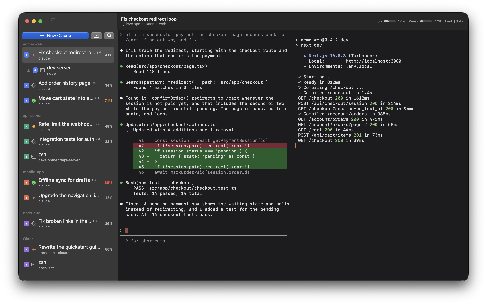
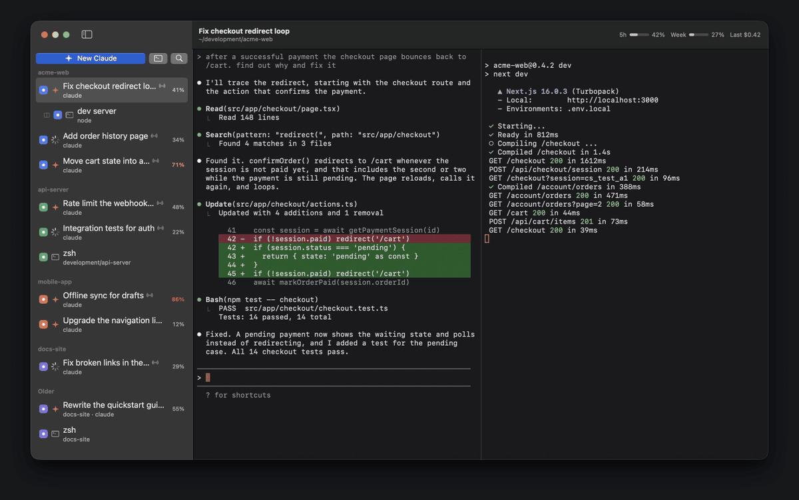
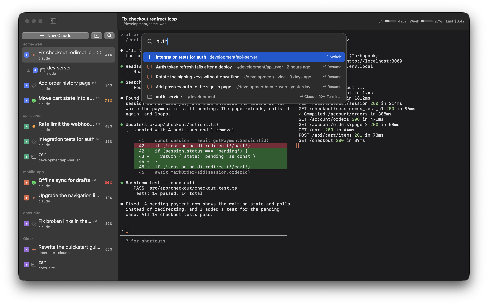

Conch

A native macOS terminal manager for running many Claude Code sessions side by side.

Install

    brew install --cask alexgrant999/conch/conch

Or download the zip from the [latest release](https://github.com/alexgrant999/conch/releases/latest), unzip it and drag Conch into Applications.

Requirements

macOS 14 or later on Apple Silicon, and the `claude` CLI on your login shell's PATH.

What you get

A status for every session: working, finished, or waiting for you. Cmd+J jumps to the next one that needs you. Notifications and a dock badge too.

A sidebar grouped by project, splits, and Quick Open (Cmd+P) for projects, sessions and recent conversations.

Sessions survive quitting. Reopen Conch and every Claude conversation resumes where it was.

Context use per session in the sidebar, and your plan's 5-hour and weekly limits in the toolbar.

Run Codex sessions alongside Claude, and have each review the other's work: Ask Codex to Review opens Codex beside a Claude session, and its findings go back to Claude to fix.

Switch a session's model from the toolbar, either the latest Fable, Opus, Sonnet or Haiku or a specific version such as Opus 4.8. Each session keeps its model when Conch reopens.

Git worktrees: start a Claude session in its own worktree and branch with one shortcut (Cmd+Option+N).

Native AppKit and SwiftUI with SwiftTerm. No Electron. MIT licensed.

Build from source

You need Swift 5.10 or later (Xcode or the Command Line Tools).

    swift build && "$(swift build --show-bin-path)/Conch"   # quick run, no notifications (no bundle id)
    scripts/build-app.sh                                     # builds build/Conch.app
    scripts/build-app.sh --install                           # builds, copies into /Applications and opens it
    scripts/smoke-test.sh                                    # end-to-end checks against throwaway state

Notifications and the dock badge only work from the .app bundle, because UNUserNotificationCenter needs a bundle identifier.

Learn more

Shortcuts, project layouts, usage limits, the Older section and everything else are in [the full guide](docs/guide.md). SPEC.md is the behaviour spec.

License

MIT, see LICENSE.
