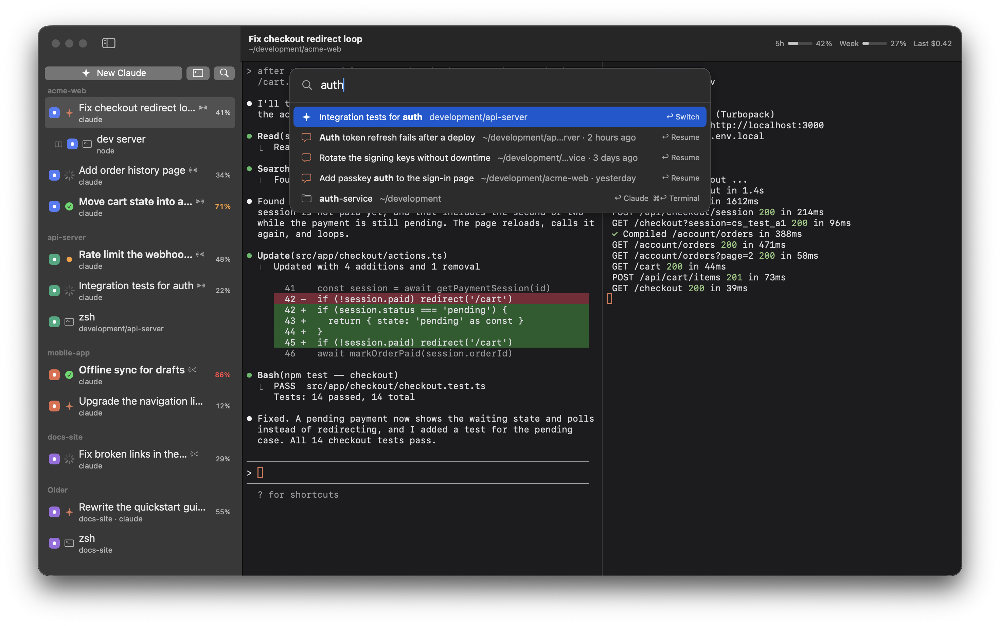

Conch guide

The full manual for Conch, a native macOS terminal manager for running many Claude Code sessions side by side. For install steps and a quick overview, see the [README](../README.md).

Requirements

macOS 14 or later, and the `claude` CLI on the login shell's PATH. The release build runs on Apple Silicon only. Swift 5.10 or later (Xcode or the Command Line Tools) is only needed to build from source, see the README.

Notifications and the dock badge only work from the .app bundle, because UNUserNotificationCenter needs a bundle identifier. A plain `swift build` run has none.

How sessions work

Every session is a pty running your login shell. A Claude session runs `claude --session-id <uuid>` inside it and drops you into a shell when Claude exits. On relaunch it comes back as `claude --resume <uuid>`, so sessions survive quitting the app. With Remote Control on (the default, in Settings), new Claude sessions also appear in claude.ai/code and the Claude mobile app.

Copy in a Claude session gives you the text the way Claude wrote it: the response marker and the two-space indent are dropped and lines Claude Code wrapped at the edge of the pane are joined back into paragraphs, so a message or a command pastes cleanly. Lists, tables and short lines stay as they are, and shell sessions copy exactly what is on screen. Turn it off in Settings, Claude, Clean up copied text.

A web session (Cmd+Shift+N) runs `claude --cloud` with a task description, or attaches to an existing one when you paste a `session_...` id or claude.ai/code link into Quick Open.

To bring a Claude Code session from another terminal into Conch, exit it there, then paste its session id (or the `claude --resume <id>` line) into Quick Open and pick Resume Claude session. It reopens in the folder it ran in and from then on restores with the app like any other session.

Quick Open

Quick Open (Cmd+P) lists sessions, layouts, folders and projects. It also lists your recent Claude conversations from ~/.claude/projects, titled by their /rename name or Claude Code's own title. Pick one to resume it in its folder. Headless `claude -p` runs and conversations whose folder no longer exists are left out.

Status in the sidebar

A spinner while a session is printing, a green check when it finished while you were looking elsewhere, an orange dot when it rang the bell or sent a desktop notification (Claude waiting for input or permission), and a small dot for unread output. Finished and waiting sessions also post a macOS notification and count toward the dock badge and the menu bar item (Settings, Show in menu bar). Cmd+J jumps to the next one: waiting before finished, oldest first.

Older

Sessions you have not used for 6 hours move to the Older section at the bottom of the session list, so the ones you are working in stay at the top. Used means typed into, printing output, or on screen, and the selected session never moves. A split moves as a whole once every pane in it has been idle that long. The list is never re-sorted by activity, so rows only move when a session crosses the line or comes back: typing into it, new output, or selecting it puts it back in its project at the place it had. Rows in Older start their second line with the project's name. The header's arrow folds the section away, and it then shows how many sessions it holds. Settings, Move idle sessions to Older after, sets the time (1 to 24 hours) or turns it off. Last active times are saved with the sessions, so this survives a relaunch.

Project layouts

Save Layout for This Project (Session menu or palette) saves the selected group's panes, for example Claude on the left and `npm run dev` on the right. Quick Open lists it as "`<project>` layout": Return opens it as one new group (each Claude pane starts a new conversation), Cmd+Return deletes it. Set Startup Command on a terminal pane runs that command when the pane starts and again every time Conch reopens. Layouts live in layouts.json next to state.json.

Worktrees

New Claude in Worktree (Cmd+Option+N) runs `claude --worktree=<name>` from the repo root, so the session works in its own git worktree and branch under `<repo>/.claude/worktrees/`. A branch icon marks it in the sidebar. Claude Code only starts in a worktree once the repo folder itself is trusted, so run `claude` there once first if it says workspace trust is not accepted.

Context

Claude sessions start with `--settings` pointing at a small statusline wrapper next to state.json. It saves the statusline data Claude Code produces (context used, window size, current conversation) for Conch, then runs your own statusline, so that keeps working. Your settings files are not changed. The sidebar shows each Claude session's context use (grey under 60%, orange from 60%, red from 80%) with advice in the tooltip. Compact, Compact With Focus, Clear Conversation and Hand Off to New Session (Session menu and palette) work on an idle Claude session. Hand Off asks Claude to write `.claude/handoff.md`, then opens a new Claude session that reads it. After a /clear, Conch follows the new conversation, so a relaunch resumes the right one.

Model

The toolbar shows the model the selected Claude session is running, for example Opus 5.5. Click it for a submenu per family (Fable, Opus, Sonnet, Haiku). Each one starts with Latest, which follows the newest model of that family, then lists the specific versions, for example Opus 5.5, Opus 5 and Opus 4.8 down to Opus 4.5. The checkmark shows which one the session is on. Other Model… takes any model id Claude Code accepts, for models the menu does not list. The Session menu has the same choices under Model. In Quick Open, Switch Model to Latest Opus and the other families are always listed, and typing finds the specific versions, for example "model 4.8". Conch types `/model <name>` at Claude's prompt, so it only switches while Claude is waiting at an empty prompt, the same as Compact. Claude Code also saves that model as its own default for new sessions.

Each session keeps its model when Conch reopens, including one you changed by typing /model yourself, because Conch passes `--model` when it resumes the conversation. A session on Latest stays on Latest, so it moves up when a newer model of that family comes out. Settings, Claude, Model for new Claude sessions picks the model new sessions start with, a Latest family or a specific version. Claude Code's default, the first choice, leaves it to Claude Code.

Codex and reviews

Session, New Codex Session (or New Codex Session in Quick Open) runs OpenAI's Codex CLI in the active folder. It needs `codex` on your login shell's PATH and works like a Claude session in the sidebar: working, finished and waiting, ⌘J, notifications. Codex picks its own session ids, so Conch reads the id from the session file Codex writes in ~/.codex/sessions and passes `codex resume <id>` when Conch reopens.

Claude and Codex can check each other's work. On a Claude session that is waiting at its prompt, Session, Ask Codex to Review (also in Quick Open) opens Codex beside it and asks it to review the uncommitted changes, or the last commit when nothing is uncommitted, without changing any project files. Codex writes its findings to `.conch/reviews/` in the project. When it has finished, Conch types a message into Claude telling it to read the review, fix what it agrees with and say what it disagrees with. On a Codex session the same item is Ask Claude to Review and works the other way round. Conch waits to hand the review over until Claude is back at an empty prompt, or until Codex is idle with nothing typed into it since the review started, and tells you when the review is ready. The `.conch` folder is added to the repository's `.git/info/exclude`, so reviews are never committed.

Usage

The toolbar shows how much of your Claude plan is used: the 5-hour and weekly limits as small bars (grey under 60%, orange from 60%, red from 80%, reset times in the tooltips), then what the active session's last prompt cost. Claude Code reports these to the statusline wrapper, so nothing extra is fetched, and each part shows once a session has reported it. Click the strip for cost by main model today and this week, and the last prompt's tokens. Costs are Claude Code's own figures at API prices and only cover sessions running in Conch. Claude Code reports one total per session and only its main model, so subagent and background spend counts under the session's main model. Per-model plan limits (an Opus-only weekly cap, for example) are not reported to Conch, so it cannot show them. Limits and daily cost by main model are kept in usage.json next to state.json, for 35 days. Settings, Show usage in toolbar, turns it off.

Project icons

Each row starts with a small icon for its project when there is one. Right-click a row or a section header and pick Set Project Icon: Choose Image (PNG, JPEG, HEIC, ICO or ICNS, Conch keeps a 64 px copy, so the original can move), Use Emoji, or Remove Icon. Without one of your own, Conch uses the project's own icon if it finds one: app/icon.png, src/app/icon.png, app/apple-icon.png, public/apple-touch-icon.png, public/icon.png, public/logo.png, public/favicon.png, app/favicon.ico, src/app/favicon.ico or public/favicon.ico, in the project folder or one level down in site/, web/ or app/. Projects in Desktop, Documents, Downloads and the other privacy-protected folders are never searched. Custom icons are kept in project-icons.json and project-icons/ next to state.json.

Shortcuts

Cmd+/ shows every shortcut inside the app. The main ones:

    Cmd+N               New Claude session in the active session's folder
    Cmd+T               New terminal
    Cmd+Shift+N         New web session
    Cmd+Option+N        New Claude session in a git worktree
    Cmd+O               Open folder
    Cmd+Shift+O         Open the current session's project folder in Finder
    Cmd+Shift+C         Copy the current Claude session's ID
    Cmd+P               Quick Open (sessions, layouts, recent conversations, folders, projects)
    Cmd+J               Jump to the next session waiting for you
    Cmd+Shift+M         Modules window
    Cmd+Shift+P         Command palette
    Cmd+D               Split right with a terminal
    Cmd+Shift+D         Split right with Claude
    Cmd+Shift+R         Rename
    Cmd+W               Close
    Cmd+K               Clear scrollback
    Cmd+B               Toggle sidebar
    Cmd+/               Show every keyboard shortcut
    Cmd+1 to Cmd+9      Jump to a session
    Ctrl+Tab            Next session (Ctrl+Shift+Tab previous)
    Cmd+Option+Arrows   Move between panes
    Shift+Return        Newline in Claude Code

State

Sessions and layout are saved to ~/Library/Application Support/Conch/state.json, project layouts to layouts.json, project icons to project-icons.json and project-icons/, and the context statusline wrapper and its readings sit in the same folder. Settings live in UserDefaults under com.alexgrant.conch.

Layout of the code

    Sources/Conch/Contract/   Shared value types
    Sources/Conch/Terminal/   Sessions, pty, activity and attention, launch commands, theme
    Sources/Conch/Model/      Session store, settings, persistence
    Sources/Conch/Services/   Notifications, project scanner
    Sources/Conch/App/        App delegate, window, menus, settings, smoke test
    Sources/Conch/UI/         Sidebar, empty state, command palette

SPEC.md is the behaviour spec.

Modules

This section is only for people who keep a folder of reusable feature modules, each with a module.json. If you do not, skip it. The Modules section stays hidden while the folder has no modules in it. The folder is ~/development/modules unless you change it in Settings, Modules folder.

The Modules section at the bottom of the sidebar lists the modules in that folder with each one's version, number of features and number of projects that installed it. Click a module, press Cmd+Shift+M, or pick "`<name>` module" in the command palette to open the Modules window: features, the projects it was built from, where it is installed (with a "behind" badge when a project has an older version), seams, env vars and dependencies. Open in Claude starts a Claude session in the module's folder. Install in Project lists the projects with a package.json and runs `node <modules folder>/bin/install.mjs <module> <project>` in a new terminal in that project after you confirm, and each project that has the module offers Show Changes (the same command with `--diff`) and Update. Update's confirmation says what install.mjs will do with files the project changed: merge them when its modules.json recorded a commit, overwrite them when it recorded "uncommitted", or write a `<file>.module` copy beside each when it recorded none. These terminals run their command once, so a relaunch brings them back as plain shells.
